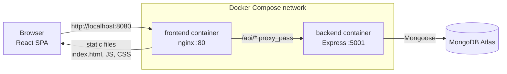
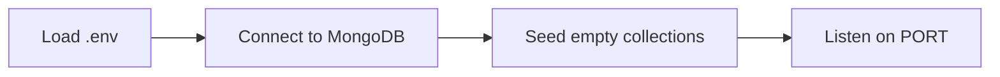
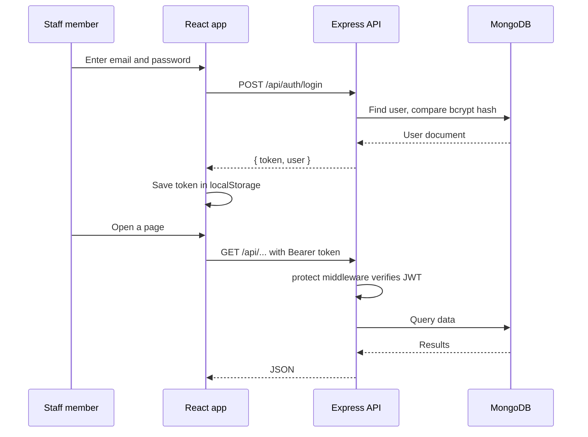
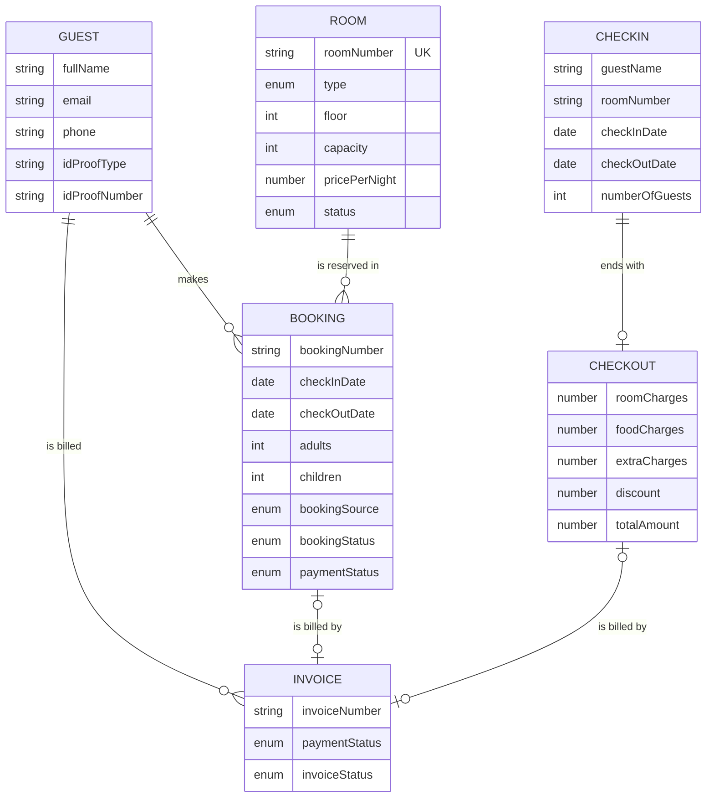
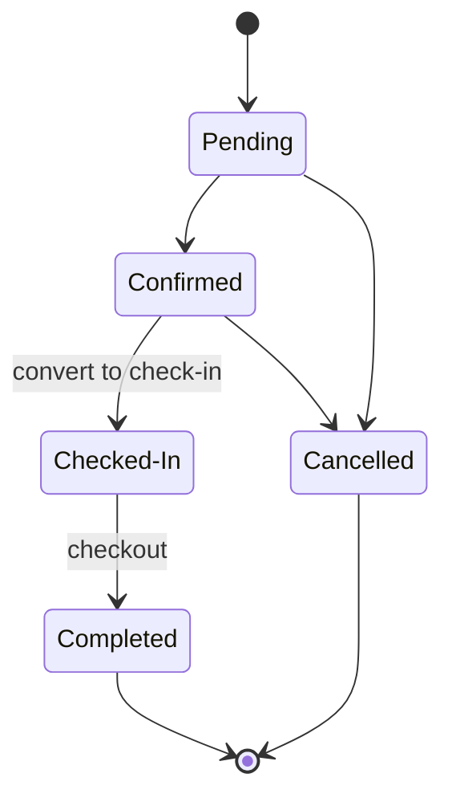
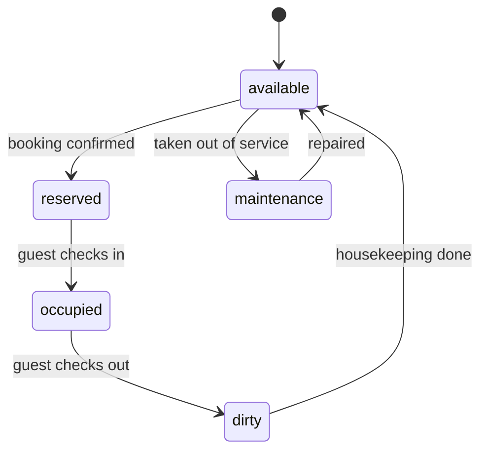
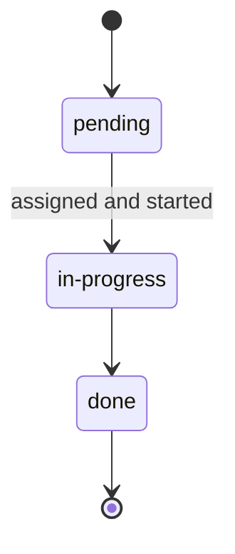

# Hotel Management System

A web application for running the day-to-day operations of a hotel: rooms, guests, reservations, check-in and checkout, housekeeping, food orders, billing and reporting. Staff sign in, manage the property from a single dashboard, and admins control hotel-wide settings and user roles.

The project is a React single-page frontend talking to a Node/Express REST API backed by MongoDB. It ships with Docker support, so the whole stack can be started with one command.


---

## Contents

- [Features](#features)
- [Tech stack](#tech-stack)
- [Architecture](#architecture)
- [Data model](#data-model)
- [Workflows](#workflows)
- [Project structure](#project-structure)
- [Getting started](#getting-started)
- [Configuration](#configuration)
- [Demo accounts and seed data](#demo-accounts-and-seed-data)
- [API reference](#api-reference)
- [Known limitations](#known-limitations)

---

## Features

| Area | What it does |
|---|---|
| **Dashboard** | Live overview of occupancy, arrivals, revenue and pending work. |
| **Rooms** | Create, edit and remove rooms; track status (available, occupied, reserved, maintenance, dirty), floor, capacity and nightly rate. |
| **Guests** | Guest directory with contact details, nationality, ID proof, emergency contact and notes. |
| **Reservations** | Bookings linked to a guest and a room, with source (walk-in, website, phone, OTA), party size, status and payment status. A booking can be converted into a check-in. |
| **Check-in / Checkout** | Register arrivals with ID details, then settle the stay: room charges, food charges, extras and discount roll up into a single total. |
| **Housekeeping** | Task board per room (cleaning, inspection, maintenance, turndown) with priority, assignee, due date and progress. |
| **Food orders** | Room-service orders with line items, order status and payment status. |
| **Billing** | Invoices with payment history, partial payments and methods (cash, card, UPI, bank transfer). |
| **Reports** | Revenue, occupancy, bookings, guests, food sales, payments and housekeeping, filterable by date range. |
| **Settings** | Hotel profile and logo, room types and default pricing, tax rate, policies, and user management with roles. |
| **Auth** | Registration, login and password change using JWT; routes in the UI are protected. |

---

## Tech stack

**Frontend**

| | |
|---|---|
| React 19 with React Router 7 | UI and client-side routing |
| Vite 8 | Dev server and production build |
| Tailwind CSS 4 | Styling |
| lucide-react | Icons |
| React Compiler | Automatic memoisation, enabled through Babel |

**Backend**

| | |
|---|---|
| Node.js (ES modules) and Express 5 | REST API |
| Mongoose 9 on MongoDB Atlas | Data layer |
| jsonwebtoken and bcryptjs | Authentication and password hashing |
| dotenv and cors | Configuration and cross-origin rules |

**Infrastructure**

| | |
|---|---|
| Docker and Docker Compose | Containerised build and run |
| nginx | Serves the built frontend and proxies `/api` to the backend |

---

## Architecture

In Docker, the browser only ever talks to nginx. Static assets are served directly; anything under `/api` is forwarded to the Express container over the internal Docker network. Because everything shares one origin, no CORS configuration is needed for the containerised setup.



On startup the backend runs a fixed sequence and exits with an error if any step fails:



Requests that need authentication carry a JWT (valid for 7 days) in the `Authorization: Bearer` header. The frontend stores it in `localStorage` and attaches it in one place, `frontend/src/api/client.js`.



---

## Data model

Core collections and how they relate. Bookings, invoices and checkouts reference each other by ObjectId.



Standalone collections that are linked by room number rather than by reference: `FoodOrder`, `HouseKeepingTask`. Configuration and identity collections: `User` (roles `user` / `admin`), `Hotel`, `HotelProfile`, `RoomSettings`.

---

## Workflows

**Booking status**



**Room status**



**Housekeeping task**



---

## Project structure

```
hotelmanagement_11-main/
├── docker-compose.yml
├── backend/
│   ├── Dockerfile
│   ├── index.js                 Entry point: app setup, routes, startup sequence
│   ├── seed.mjs                 Manual seed scripts
│   ├── drop_and_seed.js
│   └── src/
│       ├── config/db.js         MongoDB connection
│       ├── controllers/         Request handlers, one file per resource
│       ├── middleWare/          JWT auth, error handling
│       ├── models/              Mongoose schemas
│       ├── routes/              Express routers
│       └── utils/               Token generation, seeding, offline fallback
└── frontend/
    ├── Dockerfile
    ├── nginx.conf
    ├── vite.config.js
    └── src/
        ├── api/                 One module per resource, built on client.js
        ├── components/          Tables, modals, charts, badges
        ├── pages/               One file per screen
        ├── layouts/             Dashboard shell (header, sidebar, footer)
        ├── routes/              ProtectedRoute guard
        ├── context/             Hotel profile context
        └── utils/               Auth helpers
```

---

## Getting started

### Option 1: Docker (recommended)

Requires [Docker Desktop](https://www.docker.com/products/docker-desktop/).

1. Create `backend/.env` (see [Configuration](#configuration)).
2. From the project root:

   ```bash
   docker compose up --build
   ```

3. Open <http://localhost:8080>.

Useful commands:

```bash
docker compose up -d        # run in the background
docker compose logs -f      # follow logs
docker compose down         # stop and remove containers
```

Without Compose, the same result can be had with `docker network create`, `docker build` for each folder, and `docker run` for each image. The containers must share a network, and the backend container must be named `backend` because `nginx.conf` proxies to that hostname.

### Option 2: Run locally

Requires Node.js 20.19+ or 22.12+ (Vite 8 requirement) and a MongoDB connection string.

```bash
# Terminal 1: API on http://localhost:5001
cd backend
npm install
npm run dev

# Terminal 2: UI on http://localhost:5173
cd frontend
npm install
npm run dev
```

In development, Vite proxies `/api` to `localhost:5001`, and the backend allows the Vite origins (`localhost:5173` and `5174`) through CORS.

---

## Configuration

Create `backend/.env`:

```env
PORT=5001
MONGO_URI=mongodb+srv://<user>:<password>@<cluster>.mongodb.net/<database>
JWT_SECRET=<a long random string>
```

| Variable | Purpose |
|---|---|
| `PORT` | Port the API listens on. Defaults to 5001. |
| `MONGO_URI` | MongoDB connection string. The server will not start without it. |
| `JWT_SECRET` | Secret used to sign and verify tokens. Use a long random value. |

The frontend has one optional build-time variable, `VITE_API_URL`. The Docker build sets it to `/api` so requests go through nginx. If unset, it falls back to `http://localhost:5001/api`.

When using Atlas, add the IP address of the machine running the containers under **Network Access**, otherwise the backend will fail to connect.

Keep `.env` out of version control.

---

## Demo accounts and seed data

On first start, any empty collection is filled with sample data, so the app is usable immediately. Seeding is idempotent: collections that already contain data are left alone.

| Seeded | Details |
|---|---|
| Users | 11 accounts: 3 admins and 8 staff |
| Rooms | 20 rooms across 4 floors, from single to presidential |
| Hotel | "Azure Coast Grand Hotel" profile |
| Check-ins | 10 sample stays in different states |
| Housekeeping | Sample tasks |

Example logins (all seeded users share the same password):

| Role | Email | Password |
|---|---|---|
| Admin | `admin@hotel.com` | `password123` |
| Staff | `sarah@hotel.com` | `password123` |

These are demo credentials. Change them, or remove the seed, before exposing the app to anyone else.

---

## API reference

All routes are prefixed with `/api`. `GET /` returns a simple health check.

| Resource | Base path | Endpoints |
|---|---|---|
| Auth | `/auth` | `POST /register`, `POST /login`, `POST /forgot-password` |
| Rooms | `/rooms` | `GET /`, `POST /`, `GET /:id`, `PUT /:id`, `PATCH /:id/status`, `DELETE /:id` |
| Guests | `/guests` | `GET /`, `POST /`, `GET /:id`, `PUT /:id`, `DELETE /:id` |
| Bookings | `/bookings` | `GET /`, `POST /`, `GET /:id`, `PUT /:id`, `PATCH /:id/status`, `POST /:id/check-in`, `DELETE /:id` |
| Check-ins | `/checkin` | `GET /`, `POST /`, `PUT /:id`, `DELETE /:id` |
| Checkout | `/checkout` | `GET /`, `POST /`, `GET /:id`, `PATCH /:id/payment`, `DELETE /:id` |
| Housekeeping | `/housekeeping` | `GET /`, `POST /`, `PATCH /:id/status`, `DELETE /:id` |
| Food orders | `/foodorders` | `GET /`, `POST /`, `GET /:id`, `PATCH /:id/status`, `PATCH /:id/payment`, `DELETE /:id` |
| Invoices | `/invoices` | `GET /`, `POST /`, `GET /:id`, `PUT /:id`, `PATCH /:id/payment`, `DELETE /:id` |
| Reports | `/reports` | `GET /dashboard`, `/revenue`, `/occupancy`, `/bookings`, `/guests`, `/food`, `/payments`, `/housekeeping` |
| Dashboard | `/dashboard` | `GET /stats` |
| Hotel profile | `/hotel-profile` | `GET /`, `POST /`, `PUT /` |
| Settings | `/settings` | `/hotel`, `/rooms`, `/room-settings`, `/users`, `/users/:id/role`, `/me`, `/password` |

Responses are JSON. Failures return `{ "success": false, "message": "..." }` with an appropriate status code.

---

## Known limitations

This started as a coursework-scale project, and a few things would need attention before real use:

- **Authorization is uneven.** The `protect` middleware (JWT check) is applied to the dashboard, housekeeping and settings routes, but not to rooms, guests, bookings, check-ins, checkout, food orders, invoices or reports. An `adminOnly` middleware exists but is not wired to any route yet. Role-based access is currently enforced in the UI only.
- **Offline fallback accounts.** `backend/src/utils/offlineStore.js` holds hard-coded users that the auth middleware can fall back to when the database is unreachable. This is convenient for demos and should be removed for anything else.
- **Demo seed credentials** are shared and documented above.
- **CORS** is limited to localhost origins. It does not matter behind the nginx proxy, but a differently hosted frontend would need its origin added in `backend/index.js`.
- **Room links by number.** Check-ins, food orders and housekeeping tasks refer to rooms by room number string, not by ObjectId, so renaming a room does not update them.
- **No automated tests** yet.

---

## Scripts

| Location | Command | Description |
|---|---|---|
| `backend` | `npm run dev` | Start with nodemon and automatic reload |
| `backend` | `npm start` | Start the API |
| `frontend` | `npm run dev` | Vite dev server |
| `frontend` | `npm run build` | Production build into `dist/` |
| `frontend` | `npm run lint` | ESLint |
